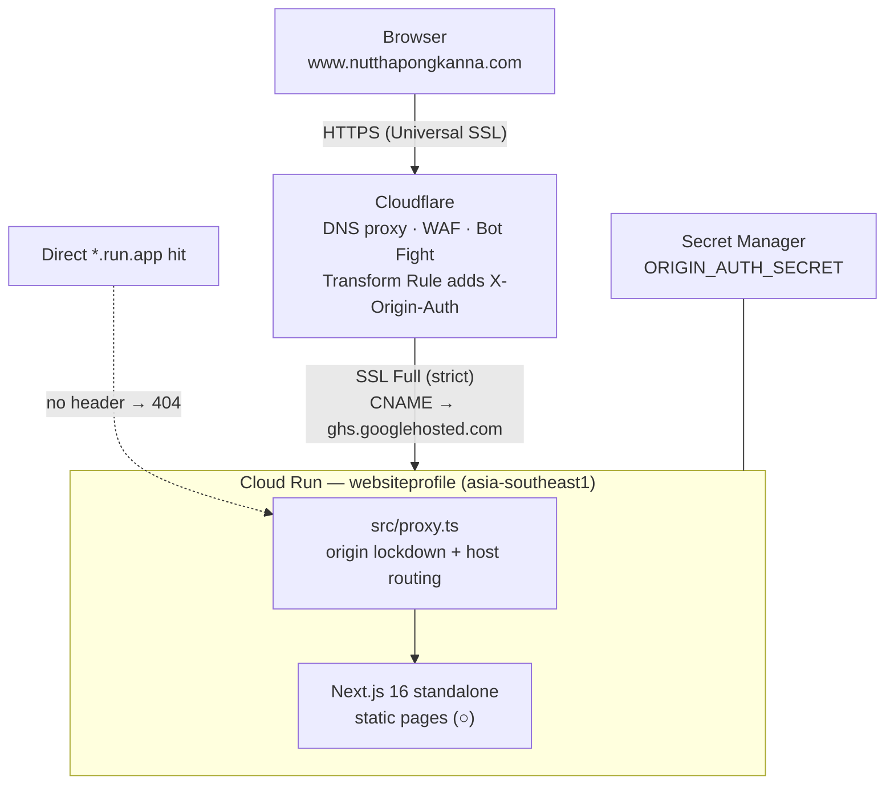
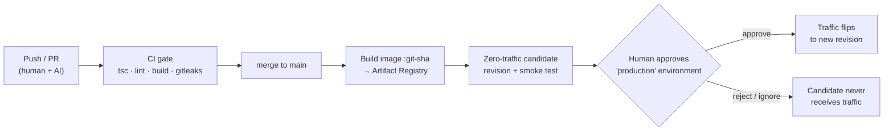

# websiteprofile

Personal profile website of Nutthapong Kanna (Cloud Engineer, Big Data
Institute). Production: https://www.nutthapongkanna.com

**Stack**: Next.js 16 (App Router) · Cloud Run · Artifact Registry ·
Cloudflare · GitHub Actions — Firebase (Firestore/Auth) and the admin CMS
are planned, not wired up yet; content currently lives in
[src/content/profile.ts](src/content/profile.ts).

| Environment | URL |
|---|---|
| Production | https://www.nutthapongkanna.com |
| Local | http://localhost:3000 |

## Quick start

Prerequisites: Node ≥ 20 (`node -v`).

```bash
git clone <repo-url> && cd websiteprofile
npm ci
cp .env.example .env.local   # defaults are fine for local dev
npm run dev                  # → http://localhost:3000
```

## Environment variables

| Variable | Where used | Example / how to get it |
|---|---|---|
| `NEXT_PUBLIC_SITE_URL` | metadata, sitemap, robots | `https://www.example.com` — leave empty locally (falls back to localhost) |
| `ORIGIN_AUTH_SECRET` | proxy (origin lockdown) | Production only; must equal the Cloudflare Transform Rule header value. Generate: `openssl rand -base64 32` |

Local: values go in `.env.local` (never committed).
Production: secrets via Secret Manager (`--set-secrets`), plain values via `--set-env-vars` / build args.

## Common commands

| Command | What it does |
|---|---|
| `npm run dev` | dev server with hot reload |
| `npm run build` | production build — run before every PR |
| `npm run lint` / `npx tsc --noEmit` | lint / typecheck |

## Project structure

```
src/app/(site)/      main website (hero, skills, experience, about, contact)
src/app/             root layout, robots, sitemap
src/content/         site content (moves to Firestore when the admin CMS lands)
src/proxy.ts         origin lockdown + host routing (www vs admin subdomain)
.github/workflows/   CI gate (PR) + deploy pipeline (main)
```

## Editing content

Until the admin CMS exists, edit
[src/content/profile.ts](src/content/profile.ts) — name, tagline, skills,
experience, links.

---

## Architecture

**Live since June 2026.** Cost-optimized serverless: Cloud Run **domain
mapping + Google-managed cert** (no load balancer) and `min-instances 1`
(one warm instance — no cold starts, ~$5–10/month). Request volume itself
fits the Cloud Run free tier; everything else (Cloudflare, GitHub
Actions, Secret Manager) is effectively free at this scale.

### Runtime — request path



Defense in depth, outermost first:

1. **Cloudflare edge** — WAF managed rules, Bot Fight Mode, TLS
   termination for browsers. Injects the `X-Origin-Auth` secret header
   into every proxied request (Transform Rule).
2. **Origin lockdown** ([src/proxy.ts](src/proxy.ts)) — any request
   without the correct header gets 404. This is why hitting the
   `*.run.app` URL directly returns 404: **working as intended, not a
   bug.** The only way in is through Cloudflare.
3. **App layer** — security headers (HSTS, CSP, X-Frame-Options DENY,
   nosniff) baked in `next.config.ts`; all public pages statically
   prerendered, no server-side data access on the public site.

TLS has two independent legs: browser→Cloudflare uses Cloudflare's
Universal SSL cert; Cloudflare→origin uses the Google-managed cert that
the domain mapping provisioned (SSL mode Full strict).

### Delivery — code path



- Rollback = shift traffic back to the previous revision (~10 seconds,
  no rebuild): commands in "Verify & rollback" below.
- The pipeline workflows exist in [.github/workflows/](.github/workflows/)
  but stay **dormant until the GitHub Variables are set** (see One-time
  setup §2) — until then, deploys are the manual command in §3.

### Key decisions (and why)

| Decision | Why |
|---|---|
| Domain mapping + Google cert, no Load Balancer | LB costs ~$18–25/mo — unjustifiable for a profile site. Mapping is free; trade-off is a one-time grey-cloud wait (~15 min) for cert provisioning |
| `min-instances 1` | No cold starts; ~$5–10/mo accepted knowingly |
| Region `asia-southeast1` | Forced: domain mappings are not allowed in `asia-southeast3` (GCP returns 501) |
| Header-based origin lockdown (not ingress restriction) | Keeps `*.run.app` reachable for CI candidate smoke tests while still blocking the public |
| Content in a file, not a CMS | A profile site edited a few times a year doesn't need a database; git is the CMS until the planned admin app justifies itself |

## One-time setup

Do these once, in order. Replace `<project-id>`, `<owner>/<repo>`, and the
domain before running.

### 1. GCP

```bash
PROJECT=<project-id>; REGION=asia-southeast1

# Artifact Registry repo for images
gcloud artifacts repositories create web \
  --project $PROJECT --location $REGION --repository-format docker

# Runtime service account (what Cloud Run runs as)
gcloud iam service-accounts create websiteprofile-runtime --project $PROJECT

# Origin-lockdown secret (same value goes into Cloudflare later — keep it)
openssl rand -base64 32 | tr -d '\n' | gcloud secrets create origin-auth-secret \
  --project $PROJECT --data-file=-
gcloud secrets add-iam-policy-binding origin-auth-secret --project $PROJECT \
  --member serviceAccount:websiteprofile-runtime@$PROJECT.iam.gserviceaccount.com \
  --role roles/secretmanager.secretAccessor

# Deployer service account (what GitHub Actions runs as)
gcloud iam service-accounts create deployer --project $PROJECT
DEPLOYER=deployer@$PROJECT.iam.gserviceaccount.com
gcloud projects add-iam-policy-binding $PROJECT --member serviceAccount:$DEPLOYER --role roles/artifactregistry.writer
gcloud projects add-iam-policy-binding $PROJECT --member serviceAccount:$DEPLOYER --role roles/run.admin
gcloud iam service-accounts add-iam-policy-binding \
  websiteprofile-runtime@$PROJECT.iam.gserviceaccount.com \
  --member serviceAccount:$DEPLOYER --role roles/iam.serviceAccountUser
gcloud secrets add-iam-policy-binding origin-auth-secret --project $PROJECT \
  --member serviceAccount:$DEPLOYER --role roles/secretmanager.secretAccessor

# Workload Identity Federation — keyless auth for GitHub Actions
gcloud iam workload-identity-pools create github --project $PROJECT --location global
gcloud iam workload-identity-pools providers create-oidc github-provider \
  --project $PROJECT --location global --workload-identity-pool github \
  --issuer-uri "https://token.actions.githubusercontent.com" \
  --attribute-mapping "google.subject=assertion.sub,attribute.repository=assertion.repository" \
  --attribute-condition "assertion.repository == '<owner>/<repo>'"
PROJECT_NUM=$(gcloud projects describe $PROJECT --format 'value(projectNumber)')
gcloud iam service-accounts add-iam-policy-binding $DEPLOYER \
  --role roles/iam.workloadIdentityUser \
  --member "principalSet://iam.googleapis.com/projects/$PROJECT_NUM/locations/global/workloadIdentityPools/github/attribute.repository/<owner>/<repo>"
```

### 2. GitHub

1. Push the repo: `gh repo create websiteprofile --private --source . --push`
2. Settings → Environments → create **`production`** → add yourself as
   **required reviewer** (this is the deploy approval gate).
3. Settings → Branches → protect `main`: require the CI check + 1 review.
4. Settings → Secrets and variables → Actions → **Variables** — set:

| Variable | Value |
|---|---|
| `GCP_PROJECT` | `<project-id>` |
| `GCP_REGION` | `asia-southeast1` |
| `SERVICE` | `websiteprofile` |
| `AR_IMAGE` | `asia-southeast1-docker.pkg.dev/<project-id>/web/site` |
| `WIF_PROVIDER` | `projects/<project-number>/locations/global/workloadIdentityPools/github/providers/github-provider` |
| `DEPLOYER_SA` | `deployer@<project-id>.iam.gserviceaccount.com` |
| `SITE_URL` | `https://www.nutthapongkanna.com` (set after step 4) |

The deploy workflow stays skipped until `WIF_PROVIDER` is set, so steps can
be done in any order without red ✗ runs.

### 3. First deploy + custom domain

The very first deploy is manual (CI needs an existing service to tag
candidates on):

```bash
gcloud run deploy websiteprofile \
  --source . \
  --project $PROJECT --region $REGION \
  --allow-unauthenticated \
  --service-account websiteprofile-runtime@$PROJECT.iam.gserviceaccount.com \
  --set-secrets ORIGIN_AUTH_SECRET=origin-auth-secret:latest \
  --memory 512Mi --cpu 1 --min-instances 1 --max-instances 10 --cpu-boost

# map the domain to the service — Google provisions a managed cert (free)
gcloud beta run domain-mappings create --service websiteprofile \
  --domain www.nutthapongkanna.com --project $PROJECT --region $REGION
```

### 4. Cloudflare (order matters)

1. **DNS**: CNAME `www` → `ghs.googlehosted.com`, **DNS-only (grey cloud)**
   first. Wait until the domain-mapping certificate finishes provisioning
   (`gcloud beta run domain-mappings describe --domain www.nutthapongkanna.com`,
   usually ~15 min), then switch the record to **Proxied (orange cloud)**.
2. **SSL/TLS → Full (strict)** — anything less causes redirect loops.
3. **Rules → Transform Rules → Modify Request Header**: on hostname
   `www.nutthapongkanna.com`, set header `X-Origin-Auth` = the value of
   `origin-auth-secret` (read it:
   `gcloud secrets versions access latest --secret origin-auth-secret`).
   Without this rule every request gets 404 from the origin lockdown.
4. **Security → WAF**: enable managed ruleset; add rate limiting
   (e.g. `/api/*` 60 req/min per IP). **Bot Fight Mode** on.
5. **Caching → Cache Rules**: cache `www.nutthapongkanna.com/*` with Edge TTL 5 min,
   bypass when a `__session` cookie is present; never cache `/api/*`.
6. Set the `SITE_URL` GitHub variable and redeploy so metadata/sitemap use
   the real domain.

## CI/CD — everyday deploys

After setup, shipping a change is:

1. Branch → PR. **CI** runs typecheck, lint, build, gitleaks — must pass.
2. Merge to `main`. **Deploy** workflow builds the image, pushes to
   Artifact Registry, deploys a **zero-traffic candidate** revision, and
   smoke-tests it. Users still see the old version.
3. GitHub → Actions → the waiting **release** job → **Review deployments**
   → approve. Traffic flips to the new revision and the workflow verifies
   the live site (200 via Cloudflare, 404 direct to run.app).

Nothing reaches users without the approval click in step 3.

## Verify & rollback

```bash
# what is live right now
gcloud run services describe websiteprofile --project $PROJECT --region $REGION \
  --format 'value(status.traffic.list(format="{0}={1}%".format(revisionName,percent)))'

# verify
curl -s -o /dev/null -w "%{http_code}\n" https://www.nutthapongkanna.com     # expect 200
curl -s -o /dev/null -w "%{http_code}\n" \
  $(gcloud run services describe websiteprofile --project $PROJECT --region $REGION \
    --format 'value(status.url)')                                  # expect 404 (lockdown)

# rollback — instant, no rebuild
gcloud run revisions list --service websiteprofile --project $PROJECT --region $REGION
gcloud run services update-traffic websiteprofile \
  --project $PROJECT --region $REGION --to-revisions <previous-revision>=100
```

A bad candidate that was never approved needs nothing — it never had
traffic; just merge the fix.

## Troubleshooting

| Symptom | Fix |
|---|---|
| Pages show as `ƒ` (dynamic) in build output | Public pages must stay static — find and remove `force-dynamic` / `cookies()` usage |
| `*.run.app` URL returns 404 | Expected — origin lockdown. Real traffic comes via Cloudflare with the `X-Origin-Auth` header |
| Site 404s through the domain too | Cloudflare Transform Rule header value ≠ `origin-auth-secret` — make them match, redeploy |
| Infinite redirect loop via Cloudflare | SSL/TLS mode must be **Full (strict)**, not Flexible |
| Domain cert stuck "provisioning" | DNS record must be grey-cloud (DNS-only) until the cert issues, then re-enable proxy |
| Unexpected idle cost on the bill | `min-instances 1` keeps one warm instance (~$5–10/mo) — drop to 0 if cost matters more than cold starts |
| Deploy job skipped on push to main | `WIF_PROVIDER` variable not set yet — intended until GCP setup is done |
| `auth@v2` fails in Actions | WIF `attribute-condition` must equal `'<owner>/<repo>'` exactly |
| Release ran without approval | `production` environment is missing required reviewers |
| Fonts fail to load during build | `next/font` fetches Google Fonts at build time — needs network access |
